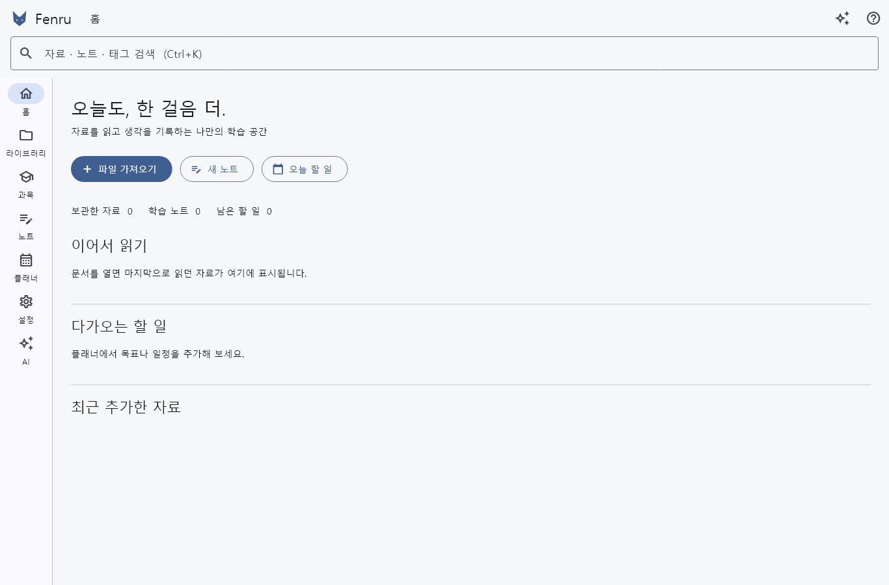
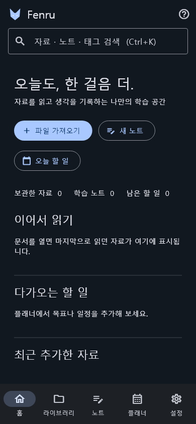

# Fenru

내 기기에 자료와 학습 기록을 보관하는 Windows / Android용 Flutter 학습 워크스페이스입니다.

**개발 프리릴리스입니다. 전체 제품 요구사항 구현은 완료되지 않았습니다.** Google Drive 자동 동기화는 아직 제공하지 않습니다. AI는 BYOK 코드와 모의 테스트를 검증했으며 실제 생성 API 성공은 미검증입니다. [구현 현황](docs/IMPLEMENTATION_STATUS.md)을 확인하세요.

## 다운로드

검증된 릴리스가 생성되면 [GitHub Releases](https://github.com/vividhyeok/fenru/releases)에서 Windows Portable ZIP과 Android APK를 제공합니다. 현재 문서는 다운로드 파일의 존재를 보장하지 않습니다.

## 구현한 기능

- 로컬 전용 온보딩과 라이트/다크 테마
- 파일 가져오기·해시 중복 검사·이름/폴더/태그·휴지통
- PDF 열람·본문 검색·페이지 이동·읽던 위치·책갈피·페이지 메모·선택 하이라이트/밑줄
- 텍스트와 이미지 미리보기, 다른 형식은 외부 앱으로 열기
- Markdown 노트 편집·자동 저장·미리보기·자료 연결
- 제목/노트/텍스트 검색, 학습 일정·완료 체크
- Canvas HTTPS 주소와 보안 토큰 설정, 선택 과목 파일·과제 가져오기
- ZIP 백업 및 벡터 시계 기반 병합·충돌 복사본
- 앱 내부 도움말과 오픈소스 라이선스 화면
- OpenAI Responses / DeepSeek BYOK 설정, 모델 조회/직접 입력, 스트리밍·취소·대화 보관, PDF 페이지 컨텍스트와 검증된 내부 출처 링크

## 개발

Flutter **3.47.7 / Dart 3.13.5**를 사용합니다. 패키지는 pubspec.yaml에 고정합니다.

```sh
python tools/bootstrap.py
flutter pub get
dart format lib test integration_test
flutter analyze
flutter test
flutter run -d windows
flutter build windows --release
flutter build apk --release
```

최초 환경에서는 bootstrap이 Flutter 공식 플랫폼 러너를 생성합니다. Android SDK 및 Java, Windows Visual Studio C++ 도구가 필요합니다. CI는 플랫폼별 러너를 생성하여 빌드합니다.

## 사용

첫 실행에서 연결 없이 시작할 수 있습니다. 홈 → 파일 가져오기에서 자료를 선택하세요. 자료 메뉴에서 이름·폴더·태그를 수정하고 연결 노트를 작성할 수 있습니다. 설정 → 도움말에서 상세 사용법을 확인하세요. Ctrl+K 검색, Ctrl+O 가져오기, Ctrl+N 새 노트.

Canvas는 학교 HTTPS 기본 주소와 개인 액세스 토큰을 설정한 후 과목 화면에서 가져옵니다. API 키가 필요하지 않은 로컬 기능은 오프라인에서도 사용할 수 있습니다. 설정 → AI API 키·모델 설정에서 OpenAI/DeepSeek 키를 입력합니다. Google OAuth 연결은 구현 예정입니다.

Windows는 설치 프로그램 또는 Portable ZIP을 사용합니다. DLL과 data 폴더를 함께 보관하세요. 서명되지 않은 Windows 프로그램은 SmartScreen 안내가 표시될 수 있습니다. Android release.apk는 프로젝트 서명 키로 서명하며, test-signed.apk는 임시 테스트 키 빌드입니다. 두 종류는 서로 덮어 업데이트할 수 없습니다.

## 데이터와 개인정보

SQLite와 파일은 앱 지원 디렉터리/workspace에 보관합니다. 실행 파일 교체와 별도로 유지됩니다. 원본 자료를 수정하지 않습니다. 토큰은 OS 보안 저장소에 저장되며 백업에서 제외됩니다. ZIP은 암호화되지 않습니다. 기기 간 이동은 백업/병합 복원을 사용하세요. 자동 클라우드 동기화는 지원하지 않습니다. 추적·광고 SDK가 없습니다.

## 문서와 기여

[사용 설명서](docs/USER_GUIDE.md) · [보안](docs/SECURITY.md) · [설계](docs/ARCHITECTURE.md) · [라이선스](docs/OPEN_SOURCE.md) · [기여](CONTRIBUTING.md)

[문제 보고](https://github.com/vividhyeok/fenru/issues)에 재현 과정과 OS를 남겨 주세요. 토큰·API 키·개인 자료를 첨부하지 마세요. 실행 화면 스크린샷은 실제 GUI 검증 후 추가합니다.

## 화면

아래 이미지는 실제 Flutter 위젯 테스트가 렌더링한 빈 상태입니다. 실기기 캡처와 구분합니다.



