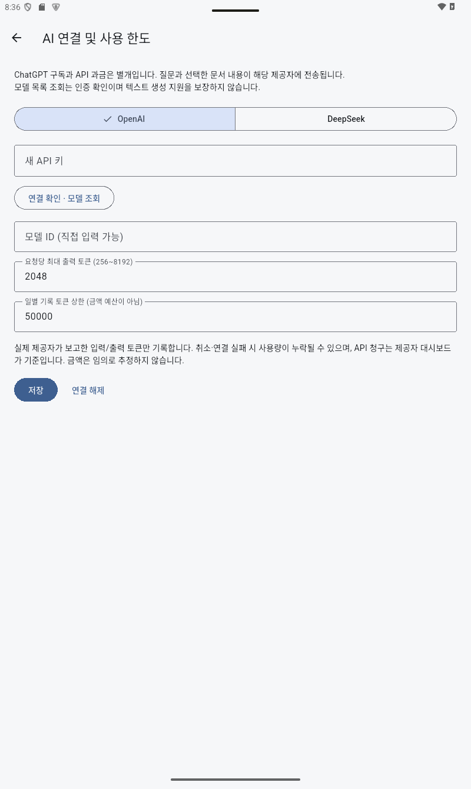

# AI 연결

설정 → AI API 키·모델 설정에서 OpenAI 또는 DeepSeek를 선택하고 새 키를 입력합니다. 연결 확인·모델 조회 후 텍스트 생성 모델을 선택하거나 모델 ID를 직접 입력한 뒤 저장하세요. 빈 키 입력은 기존 보관 키를 유지합니다. 연결 해제는 해당 제공자의 키를 삭제하고 대화는 유지합니다. 키 없이 로컬 기능을 사용할 수 있습니다. 키를 채팅이나 이슈에 올리지 마세요.

키는 OS 보안 저장소에 보관합니다. OpenAI Responses API(store=false)와 DeepSeek Chat Completions API를 사용합니다. 스트리밍·취소·부분 답변 보관, 메시지 복사·노트 저장, 제공자가 보고한 사용량 기록을 구현했습니다. ChatGPT 구독과 API 청구는 별개입니다. 개발자 환경 키를 배포 앱에 포함하지 않습니다.

PDF → 더보기 → AI에게 질문에서 선택 영역 또는 현재 페이지를 포함할 수 있습니다. 전송 스위치를 확인하세요. 컨텍스트 12,000자, 최근 메시지 최대 20개이며 여러 페이지 선택은 현재 거부합니다. 모델의 내부 페이지 링크는 실제로 제공한 문서 ID/페이지와 일치할 때만 이동합니다. 전체 문서/과목/라이브러리 RAG는 아직 없습니다.

출력 한도 256~8192, 일별 토큰 상한을 설정합니다. 일별 기록과 보수적 예상 입력 크기로 요청을 제한하지만 금액 예산은 아닙니다. 실패·취소 시 사용량이 누락될 수 있으며 실제 청구는 제공자 대시보드 기준입니다. 자동 유료 요청 재시도는 없습니다.

2026-10-21 개발 환경 기존 키 재사용을 사용자에게 승인받아 공식 /v1/models를 요청했으나 HTTP 401이었습니다. 따라서 실제 생성 API 성공은 검증하지 못했습니다. 새 키는 사용자 앱 설정에 직접 입력합니다. SSE 처리와 비밀을 제외한 오류 메시지는 모의 HTTP로 검증했습니다.

OpenAI 공식 문서 확인: https://developers.openai.com/api/reference/resources/responses/methods/create
DeepSeek 공식 문서: https://api-docs.deepseek.com/

관련 문서: 앱 내부 도움말, SECURITY.md. 정교한 검색 기반 RAG·금액 경고·재생성·전체 대화 관리 UI는 후속 작업입니다.

alpha.2 프로젝트 키 서명 APK의 Android API 35 태블릿 에뮬레이터 실제 설정 화면입니다. API 키는 입력하지 않았습니다.

